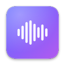
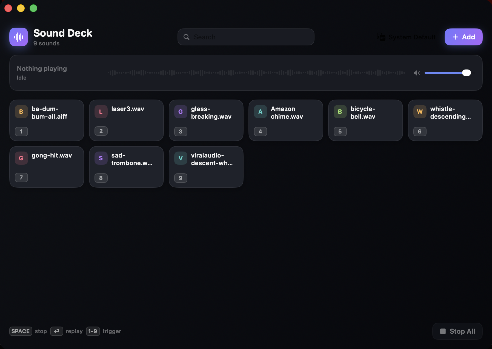

# Sound Deck

<p align="center">
  
</p>

<p align="center">
  
</p>

Sound Deck is a soundboard for macOS. Add your audio files to the deck. Press a key to play them. Send the audio to your speakers or to a call.

## Features

### Playback

- Sounds play at the same time. A new sound does not stop the previous sound.
- Each sound has its own volume level. The deck also has a master volume.
- The deck measures the loudness of each sound and plays all sounds at the same level. You can turn this off for one sound.
- A limiter stops clipping when loud sounds play together.
- Sounds fade out when they stop. They do not cut off. You can set the fade-in and fade-out time for each sound.
- Each sound has a play mode: Play over, Restart, Toggle or Hold. A Hold sound plays while you hold its key or the mouse button.
- A choke group stops the other sounds in the group, for example music beds.
- A sound can duck the other sounds while it plays.
- You can change the pitch and the speed of each sound.
- You can trim a sound to a shorter section.
- You can set a sound to loop.
- Each sound has a three-band EQ.
- A pad shows its progress while it plays. A pad that fails shows a red mark. The window never shows an alert during a show.
- The deck shows a waveform and a playhead during playback.

### Triggers

- Each pad has a keyboard key. Press the key to play the pad.
- Global hotkeys work in all applications. Press Control-Option and the key of the pad. While VoiceOver is on, press Control-Option-Command.
- The menu bar icon opens a compact grid of pads. A red Stop bar shows while a sound plays.
- Press Command-Option-F to show the floating deck. It stays above your meeting app. A click on a pad does not move the focus away from the meeting app.
- Press Space to stop all sounds. Press Return to play the focused pad, or the last sound again.
- Press Tab or an arrow key to move the focus between pads.
- Select List above the pads to use a cue list. Press the period key to play the next cue.

### Control from other apps and devices

- **URLs:** `sounddeck://play/<pad>`, `sounddeck://release/<pad>`, `sounddeck://stop`, `sounddeck://stop/<pad>` and `sounddeck://deck/<deck>`. Percent-encode spaces.
- **Shortcuts:** the actions Play Pad, Stop Pad, Stop All Pads and Select Deck.
- **MIDI:** turn on MIDI in Settings > MIDI. In the settings of a pad, click Learn and press a pad on your controller.
- **OSC:** turn on OSC in Settings > OSC. Send `/sounddeck/play "<pad>"` to port 9000. `/sounddeck/stop` stops all pads, and `/sounddeck/deck "<name>"` selects a deck.
- **Web remote:** turn it on in Settings > Web Remote. Scan the QR code with a phone on the same network.
- **Twitch chat:** turn it on in Settings > Twitch and type your channel name. Viewers type `!sound <pad>` to play a pad.
- **Stream Deck:** the folder `StreamDeckPlugin/` holds a plugin. Read `StreamDeckPlugin/README.md` to build and install it.

### Output

- You can select the output device.
- Select a virtual device to send the audio to a call or to a stream.
- The device menu shows virtual devices in a separate group.
- Select your headphones as the Monitor device to hear the deck yourself.
- Each pad plays on Both outputs, on Live only, or on Me only. Use Me only to try a sound that the call does not hear.
- The deck can mix your microphone into its output.

### Library

- Drag audio files onto the window to add them. You can add more than one file.
- You can search the deck.
- You can drag a pad to a new position.
- You can rename a pad.
- You can set a colour and an emoji for each pad.
- You can make more than one deck, for example "Podcast" and "Stream". The keys play the pads of the active deck.
- You can move a pad to another deck.
- The deck keeps a copy of each file that you add. If you move or delete the original file, the pad still plays.
- You can export a deck to one `.sounddeck` file and import it on another Mac.
- You can record a new pad from your microphone. Trim the silence before you add it.
- You can make a pad that speaks a phrase. Select Add > Speech Pad.
- You can find sounds on freesound.org. Select Add > Freesound. Paste a free API key in Settings > Freesound first. The sheet copies the credits for the deck.
- You can mark a pad as a favorite. The Favorites and Recent chips show pads from all decks. A search finds pads in all decks.
- You can lock a deck to prevent changes.

## Send the audio to a call

The deck sends audio to your speakers. Other people in a call cannot hear this audio. To send the audio to a call, do the steps that follow.

1. Install a virtual audio device. To install BlackHole, type `brew install blackhole-2ch`.
2. In Sound Deck, open the output menu in the header.
3. Select the virtual device from the **Virtual** group.
4. In Zoom, Discord, Meet or OBS, set the microphone to the same virtual device.

The call now receives the audio from the deck. The call does not receive your voice.

To send your voice and the deck audio together, do the steps that follow.

1. Open **Settings › Audio**.
2. Turn on **Mix my microphone into the deck output**. Allow the microphone access.
3. In the call app, select only the virtual device as the microphone.

You do not need an aggregate device. To hear the deck yourself, select your headphones as the **Monitor** device in the same tab.

To play sounds without leaving the call window, press Command-Option-F to show the floating deck. You can also turn on global hotkeys in **Settings › General**. Then press Control-Option and the key of a pad.

## Install

1. Download the latest `.dmg` file from [Releases](../../releases/latest).
2. Open the file. Drag Sound Deck to the Applications folder.
3. Open Sound Deck. The application is not notarized, so macOS stops it the first time. Close the warning.
4. Open **System Settings › Privacy & Security**. Click **Open Anyway**. You do this step one time only.

## Requirements

- macOS 14.6 or later
- Xcode 16 or later to build the application

## Build

To build the application in Xcode, do the steps that follow.

1. Clone the repository.
2. Open `SoundDeck.xcodeproj`.
3. Press Command-R.

To build the application from a terminal, type the command that follows.

```bash
xcodebuild -project SoundDeck.xcodeproj -scheme SoundDeck -configuration Debug build
```

## The application does not use the sandbox

Sound Deck does not use the App Sandbox. This is deliberate.

The application uses bookmarks to keep access to the files that you add. The system attaches a security-scoped bookmark to the code signature of the application. This project uses an ad-hoc signature, because it does not assume a paid Apple Developer account. An ad-hoc signature has no identity. Therefore the system cannot create a security-scoped bookmark. The operation fails with error 256 in `NSCocoaErrorDomain`. The file is readable, but the operation still fails.

A plain bookmark cannot restore access in the sandbox. A sandboxed application with an ad-hoc signature loses all added sounds at the next start.

The application does not use the sandbox. Plain bookmarks are correct in this condition. macOS can ask for access to a folder such as Downloads. This is a standard TCC request. Give the access one time.

If you have an Apple Developer Team ID, do the steps that follow.

1. Set the Team ID on the target.
2. Add the three entitlement keys from `SoundDeck/SoundDeck.entitlements`.

The application tries a security-scoped bookmark first. It uses a plain bookmark only if the first operation fails. Therefore the application changes to security-scoped bookmarks automatically.

## Credits

- Built with SwiftUI, AVFoundation and CoreAudio
- The script `Tools/MakeIcon.swift` creates the application icon
- The script `Tools/MakeSounds.mjs` creates the nine bundled sounds. It uses the Web Audio synthesis of the [quietpixel.dev](https://quietpixel.dev) demo

## License

[MIT](LICENSE)

---

Send your requests and problem reports to the issue tracker.
